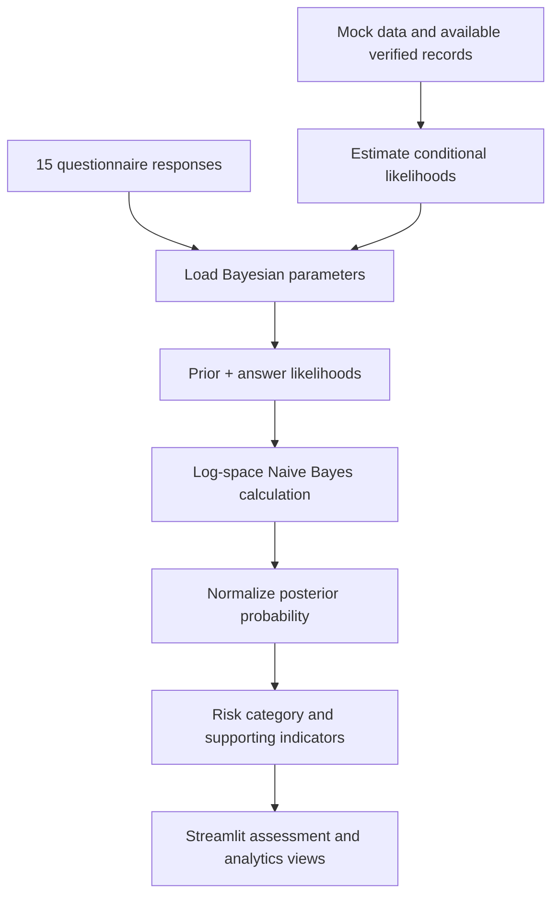

# SurvAI — Micro-Business Survival Predictor

<p align="center">
  <strong>A Bayesian decision-support prototype for informal micro-businesses.</strong><br/>
  Estimate an 18-month survival probability from a 15-question assessment — without requiring financial statements.
</p>

<p align="center">
  
  
  
  
</p>

---

## Overview

Small informal businesses often operate without the financial records used by conventional credit and risk-assessment systems. SurvAI explores a lightweight alternative: a structured questionnaire that turns business-owner responses into a model-based survival estimate and supporting indicators.

The application asks 15 questions and combines the answers with a fixed 30% prior survival probability using a Naive Bayes approach. It presents the resulting estimate alongside a risk category, a Wilson-score interval, and answer-level strengths and weaknesses.

> **Important:** SurvAI is an educational/research prototype, not a validated financial, lending, or business decision system. Its current training data includes generated mock records. Predictions must not be treated as real-world guarantees or used as the sole basis for financial decisions.

## What it does

- **15-question assessment** — collect structured responses without requesting financial documents.
- **Bayesian estimate** — update a fixed prior with conditional answer likelihoods.
- **Risk interpretation** — group the resulting estimate into Low, Medium, or High Risk categories.
- **Explainability cues** — surface the strongest and weakest answer-level likelihood contributions.
- **Statistics learning workspace** — explore probability and descriptive/inferential statistics concepts through the app.
- **Data records** — maintain assessment and feedback data in CSV files.
- **Interactive visualizations** — use Plotly charts within the Streamlit interface.

## How the model works

The model estimates the posterior probability of survival given the 15 responses:

\[
P(S\mid Q_1,\ldots,Q_{15}) \propto P(S)\prod_{i=1}^{15}P(Q_i\mid S)
\]

It performs the corresponding calculation for failure and normalizes the two values to obtain a probability between 0 and 1.

1. Start with the configured prior: \(P(S)=0.30\), \(P(F)=0.70\).
2. Read the learned likelihood of each selected answer under each outcome.
3. Apply Laplace smoothing while estimating categorical likelihoods.
4. Accumulate log-likelihoods to avoid numerical underflow.
5. Normalize the survival and failure scores.
6. Apply the project's business-age odds adjustment and clamp the displayed probability to the configured range.

The implementation also calculates a Wilson-score interval using the model's stored record count. This is a model-side interval, **not proof of external predictive calibration**.

### Model flow



## Statistics concepts explored

The project connects its interface and implementation with concepts including:

- Measures of central tendency and dispersion
- Box plots and exploratory data analysis
- Probability and conditional probability
- Contingency tables and the chi-square test
- Multiplication rule and law of total probability
- Bayes' theorem and random variables
- Binomial, Poisson, and normal distributions
- Confidence intervals and model evaluation

The exact visualizations and calculations are implemented across the application and model modules; this list is a learning map, not a claim that every concept is part of the prediction formula.

## Repository structure

```text
Surv-AI/
├── app.py                    # Streamlit interface and application views
├── model.py                  # Bayesian model and statistical helpers
├── generate_mock_data.py     # Generate the development dataset
├── requirements.txt          # Python dependencies
├── data/
│   ├── mock_data.csv         # Generated development data
│   ├── user_responses.csv    # Assessment responses / outcomes
│   └── feedback_data.csv     # User feedback records
├── model/
│   └── bayesian_model.json   # Stored model parameters
└── .streamlit/
    └── config.toml           # Streamlit configuration
```

## Run locally

### 1. Clone the repository

```bash
git clone https://github.com/Muhammad-Tayyab-official/Surv-AI.git
cd Surv-AI
```

### 2. Create a virtual environment

**Windows PowerShell**
```powershell
python -m venv .venv
.\.venv\Scripts\Activate.ps1
```

**macOS / Linux**
```bash
python3 -m venv .venv
source .venv/bin/activate
```

### 3. Install dependencies

```bash
python -m pip install --upgrade pip
pip install -r requirements.txt
```

### 4. Generate development data

```bash
python generate_mock_data.py
```

### 5. Launch the application

```bash
streamlit run app.py
```

Open the local URL printed by Streamlit (normally `http://localhost:8501`).

## Technology stack

| Area | Tools |
|---|---|
| Language | Python |
| Application | Streamlit |
| Data handling | Pandas, NumPy |
| Visualization | Plotly |
| Statistical routines | SciPy |
| Prediction approach | Categorical Naive Bayes with Laplace smoothing |

## Current limitations

- The configured 30% prior is fixed in the current implementation.
- The independence assumption of Naive Bayes may not hold for real business indicators.
- Generated mock records are useful for development and demonstration, but do not establish real-world validity.
- A reliable evaluation requires a sufficiently large, representative dataset with independently verified long-term outcomes.
- The displayed probability and interval are estimates from the current model, not guarantees.
- The application should be treated as a prototype until it has been independently evaluated and calibrated.

## Roadmap

- [ ] Add a documented, ethically sourced real-world evaluation dataset.
- [ ] Report held-out performance, calibration, and uncertainty transparently.
- [ ] Add reproducible tests for data validation and prediction behavior.
- [ ] Document data retention, consent, and privacy controls for real deployments.
- [ ] Publish a verified hosted demo and genuine application screenshots.

## Author

**Muhammad Tayyab** — Mathematics with Data Science Student

- GitHub: [@Muhammad-Tayyab-official](https://github.com/Muhammad-Tayyab-official)
- LinkedIn: [Tayyab Younas](https://www.linkedin.com/in/tayyab-younas-05b068389/)
- Portfolio: [my-portfolio](https://my-portfolio-chi-amber-40.vercel.app/)

---

<p align="center"><sub>Built as a learning project at the intersection of mathematics, statistics, and data science.</sub></p>
